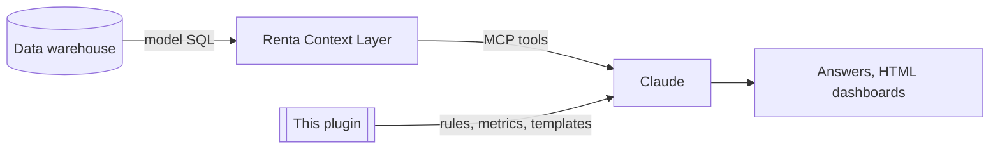

# renta-igaming-analytics: Claude skills for iGaming analytics through Renta

🇺🇦 Українська версія: [README.uk.md](README.uk.md)

**Version:** 0.4.0 · **Content:** instructions and metric rules only. No company data (no figures, ids, provider or partner names, model schemas).

## What it is

A Claude plugin: 8 skills and 5 commands that teach Claude to query an iGaming data warehouse through the **Renta Context Layer** (MCP) correctly and consistently: which tools to call in which order, how to avoid common data traps, how to calculate standard metrics, how to draw dashboards, and what Claude must never do.

## What's inside

| Skill | Purpose |
|---|---|
| `renta-querying` | Tool order, member naming, date filters, scan limits, data policy, read-only rule, answer format, generic data pitfalls |
| `igaming-metrics` | Standard metric definitions (FTD, GGR, NGR, ARPU, CPA, ROMI…) and a multilingual glossary; unapproved formulas are never invented, only labelled "candidate" |
| `player-revenue-analytics` | Activity, deposits, GGR/bonus GGR, VIP, casino, top players |
| `payments-analytics` | Success rate by provider, volume, processing time |
| `marketing-affiliate-analytics` | Registration cohorts, FTD, costs by type, partner ranking |
| `risk-analytics` | Multiaccount and compliance-proxy signals; never prints personal data |
| `renta-visuals` | Chart selection, dashboard template, `build_report.py`, Mermaid diagrams, on-demand dashboard algorithm |
| `renta-model-builder` | Designs model SQL, measures plan and descriptions (dbt `schema.yml` / Renta Metadata) |

Commands (`/renta-igaming-analytics:<name>`):

| Command | What it does |
|---|---|
| `renta-brief [date] [region]` | Daily briefing: the last full day vs the same weekday last week, anomalies (`scripts/anomalies.py`, robust z-score) and stale models, as a dashboard |
| `renta-why <metric> [date] [by dimension]` | Splits a change across a dimension (`scripts/why.py`); ratios are split into rate and mix effects |
| `renta-dashboard <metric> [period] [breakdown]` | HTML dashboard for any model and metric; checks window, cumulative columns, units, row limits and PII first |
| `renta-check [golden.json]` | Re-runs reference queries and reports drift (`scripts/check.py`), to catch silent changes in models |
| `renta-start` | Short menu with example requests |

Dashboards support tabs (`tab` on a chart), alert lines (`alerts`), status badges taken from `references/metrics_registry.json` (`metric` key; unapproved metrics get a "candidate" or "not approved" badge), print to PDF and localized labels (`labels`). A local override file named by `RENTA_METRICS_STATUS` (`{"ggr": "approved"}`) changes a status in one place.

## Rules baked into the skills

- Renta is **read-only** (`context_layer`, and `manage_data_models` list/get/schema). No create, update or delete, even if the user "confirms".
- Contacts, names, documents, cards, IPs and device ids are never shown. Player ids and aggregates are allowed.
- Never invent a formula: show the components and label "candidate / not approved".
- Never sum cumulative columns over days or currencies; count people with distinct-count measures.
- State model, period (UTC), filters and currency with every number; mark preliminary days.

## Local knowledge pack (optional, not published)

Company-specific facts (model catalog, windows, units, partner and provider names, verified reference numbers, approval status of formulas, tests) belong in a local `private/` folder at the plugin root. It is in `.gitignore` and not packaged by `build.sh`. Skills read `private/README.md` when it exists; without it, Claude discovers models with `list_models`, `describe_model` and `sample_field` and treats nothing as pre-verified.

## Install

- **Try locally:** `claude --plugin-dir /path/to/this/repo`
- **From a marketplace:** `/plugin marketplace add <owner>/<repo>`, then `/plugin install renta-igaming-analytics@<marketplace>`
- **claude.ai:** `./build.sh` builds one zip per skill in `dist/`; upload them under Organization settings → Skills.
- **Prerequisite:** the Renta connector enabled in Claude.

## Before publishing

Run `./leak_check.sh`. It scans the public tree for terms listed in `private/leak_terms.txt` (one regex per line, kept out of the repo) and for number patterns that look like business figures. It must print `clean`.

## Maintenance

| Change | Update |
|---|---|
| A formula was approved | the mapping and status in `private/metrics_map.md` (the definition in `skills/igaming-metrics/references/metrics.md` only if it changed) |
| A Renta model changed | `private/models.md` and `private/golden_queries/` |
| A new generic data trap | `skills/renta-querying/references/pitfalls.md` |
| Any skill change | test it, then `./build.sh` |
| Any script or template change | `python3 tests/test_scripts.py`, then `./leak_check.sh` |
