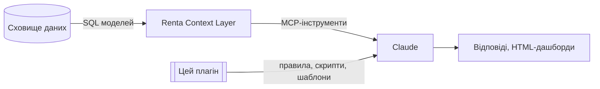

# renta-igaming-analytics: скіли Claude для iGaming-аналітики через Renta

🇬🇧 English version: [README.md](README.md)

**Версія:** 0.5.0 · **Зміст:** лише інструкції, скрипти й статуси метрик. Жодних даних компанії (цифр, id, назв провайдерів і партнерів, схем моделей).

## Що це

Плагін для Claude: 2 скіли, 5 команд і 3 скрипти для **Renta Context Layer** (MCP). Визначення метрик, зміст колонок і пастки в даних мають жити в описах моделей у Renta Metadata, а не тут. Плагін додає те, чого метадані не вміють: детерміновані розрахунки (аномалії, розклад зміни, регресійні перевірки), дашборди, спільні правила запитів (`references/rules.md`) і промпт для щоденного брифінгу без запиту (`routines/daily-brief.md`).

## Що всередині

| Скіл | Для чого |
|---|---|
| `renta-visuals` | Вибір графіка, шаблон дашборда, `build_report.py`, Mermaid, алгоритм дашборда на запит |
| `renta-model-builder` | Перевірки (лише читання) джерел, пайплайнів, невдалих запусків, якості трекінгу й Customer 360 (`references/platform-tools.md`); Проєктує SQL моделі, план показників і описи (dbt `schema.yml` / Renta Metadata) |

Команди (`/renta-igaming-analytics:<назва>`):

| Команда | Що робить |
|---|---|
| `renta-brief [дата] [регіон]` | Ранковий звіт: останній повний день проти того ж дня тижня тому, аномалії (`scripts/anomalies.py`, робастний z-score) і застарілі моделі, у вигляді дашборда |
| `renta-why <метрика> [дата] [за розрізом]` | Розкладає зміну по розрізу (`scripts/why.py`); для відсотків окремо ефект ставки й ефект структури |
| `renta-dashboard <метрика> [період] [розріз]` | HTML-дашборд для будь-якої моделі й метрики; спершу перевіряє вікно, кумулятивні колонки, одиниці, ліміти рядків і PII |
| `renta-check [golden.json]` | Перезапускає контрольні запити й показує відхилення (`scripts/check.py`): ловить тихі зміни в моделях |
| `renta-start` | Коротке меню з прикладами запитів |

Дашборди підтримують вкладки (`tab` у графіка), рядки-попередження (`alerts`), бейджі статусу з `references/metrics_registry.json` (ключ `metric`; незатверджені метрики отримують бейдж «кандидат» або «не затверджено»), друк у PDF і локалізовані підписи (`labels`). Локальний файл, названий змінною `RENTA_METRICS_STATUS` (`{"ggr": "approved"}`), змінює статус в одному місці.

## Правила, вшиті в команди (`references/rules.md`)

- Renta **лише читається** (`context_layer`, а `manage_data_models` лише list/get/schema). Створення, зміна й видалення заборонені, навіть якщо користувач «підтверджує».
- Контакти, імена, документи, картки, IP й ідентифікатори пристроїв не показуються. Id гравців і агрегати можна.
- Формули не вигадуються: показуємо складові й позначку «кандидат / не затверджено» (мовою користувача).
- Кумулятивні колонки не сумуються по днях і валютах; людей рахуємо через distinct-міру.
- До кожної цифри: модель, період (UTC), фільтри, валюта; неповні дні позначені.

## Локальний пакет знань (необов'язково, не публікується)

Усе, що специфічне для компанії (каталог моделей, вікна, одиниці, назви партнерів і провайдерів, перевірені контрольні цифри, статус затвердження формул, тести), лежить у локальній папці `private/` у корені плагіна. Вона в `.gitignore` і не потрапляє в zip від `build.sh`. Команди читають `private/models.md`, `private/model_limits.md` і `private/golden.json`, якщо вони є; без них Claude сам знаходить моделі через `list_models`, `describe_model`, `sample_field` і нічого не вважає наперед перевіреним.

## Встановлення

- **Локально для тесту:** `claude --plugin-dir /шлях/до/репозиторію`
- **Через маркетплейс:** `/plugin marketplace add <власник>/<репо>`, потім `/plugin install renta-igaming-analytics@<маркетплейс>`
- **claude.ai:** `./build.sh` збирає по zip на скіл у `dist/` (лише два скіли, що лишились; правил запитів і щодо персональних даних у них немає, тож блок із локального `private/project_instructions.md` додайте в інструкції проєкту claude.ai). Завантажуються в Organization settings → Skills.
- **Потрібно:** підключений у Claude конектор Renta.

## Перед публікацією

Запустіть `./leak_check.sh`. Він шукає в публічній частині слова зі списку `private/leak_terms.txt` (по одному regex на рядок, у репо їх немає) і числа, схожі на бізнес-цифри. Очікуваний вивід: `clean`.

## Підтримка

| Що змінилось | Що оновити |
|---|---|
| Затвердили формулу | мапінг і статус у `private/metrics_map.md`, опис у Renta Metadata і `skills/renta-visuals/references/metrics_registry.json` |
| Змінилась модель Renta | `private/models.md` і `private/golden_queries/` |
| Нова пастка в даних | опис колонки чи моделі в Renta Metadata (чернетка в `private/schema_draft.yml`) |
| Будь-яка зміна скіла | перевірити, потім `./build.sh` |
| Будь-яка зміна скрипта чи шаблона | `python3 tests/test_scripts.py` і `python3 tests/test_stress.py`, потім `./leak_check.sh` |
