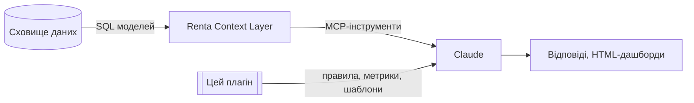

# renta-igaming-analytics: скіли Claude для iGaming-аналітики через Renta

🇬🇧 English version: [README.md](README.md)

**Версія:** 0.4.0 · **Зміст:** лише інструкції й правила розрахунку метрик. Жодних даних компанії (цифр, id, назв провайдерів і партнерів, схем моделей).

## Що це

Плагін для Claude: 8 скілів і 5 команд. Вони вчать Claude правильно й однаково працювати з iGaming-даними через **Renta Context Layer** (MCP): які інструменти й у якому порядку викликати, як обходити типові пастки в даних, як рахувати стандартні метрики, як будувати дашборди і що Claude не має робити ніколи.

## Що всередині

| Скіл | Для чого |
|---|---|
| `renta-querying` | Порядок інструментів, імена полів, фільтри дат, ліміти, політика даних, режим «тільки читання», формат відповіді, загальні пастки |
| `igaming-metrics` | Стандартні визначення метрик (FTD, GGR, NGR, ARPU, CPA, ROMI…) і багатомовний глосарій; незатверджені формули не вигадуються, лише позначаються «кандидат» |
| `player-revenue-analytics` | Активність, депозити, GGR і бонусний GGR, VIP, казино, топ гравців |
| `payments-analytics` | Успішність за провайдерами, обсяги, час обробки |
| `marketing-affiliate-analytics` | Когорти реєстрацій, FTD, витрати за типами, рейтинг партнерів |
| `risk-analytics` | Сигнали мультиакаунтів і комплаєнс-проксі; персональні дані не показує |
| `renta-visuals` | Вибір графіка, шаблон дашборда, `build_report.py`, Mermaid, алгоритм дашборда на запит |
| `renta-model-builder` | Проєктує SQL моделі, план показників і описи (dbt `schema.yml` / Renta Metadata) |

Команди (`/renta-igaming-analytics:<назва>`):

| Команда | Що робить |
|---|---|
| `renta-brief [дата] [регіон]` | Ранковий звіт: останній повний день проти того ж дня тижня тому, аномалії (`scripts/anomalies.py`, робастний z-score) і застарілі моделі, у вигляді дашборда |
| `renta-why <метрика> [дата] [за розрізом]` | Розкладає зміну по розрізу (`scripts/why.py`); для відсотків окремо ефект ставки й ефект структури |
| `renta-dashboard <метрика> [період] [розріз]` | HTML-дашборд для будь-якої моделі й метрики; спершу перевіряє вікно, кумулятивні колонки, одиниці, ліміти рядків і PII |
| `renta-check [golden.json]` | Перезапускає контрольні запити й показує відхилення (`scripts/check.py`): ловить тихі зміни в моделях |
| `renta-start` | Коротке меню з прикладами запитів |

Дашборди підтримують вкладки (`tab` у графіка), рядки-попередження (`alerts`), бейджі статусу з `references/metrics_registry.json` (ключ `metric`; незатверджені метрики отримують бейдж «кандидат» або «не затверджено»), друк у PDF і локалізовані підписи (`labels`). Локальний файл, названий змінною `RENTA_METRICS_STATUS` (`{"ggr": "approved"}`), змінює статус в одному місці.

## Правила, вшиті в скіли

- Renta **лише читається** (`context_layer`, а `manage_data_models` лише list/get/schema). Створення, зміна й видалення заборонені, навіть якщо користувач «підтверджує».
- Контакти, імена, документи, картки, IP й ідентифікатори пристроїв не показуються. Id гравців і агрегати можна.
- Формули не вигадуються: показуємо складові й позначку «кандидат / не затверджено» (мовою користувача).
- Кумулятивні колонки не сумуються по днях і валютах; людей рахуємо через distinct-міру.
- До кожної цифри: модель, період (UTC), фільтри, валюта; неповні дні позначені.

## Локальний пакет знань (необов'язково, не публікується)

Усе, що специфічне для компанії (каталог моделей, вікна, одиниці, назви партнерів і провайдерів, перевірені контрольні цифри, статус затвердження формул, тести), лежить у локальній папці `private/` у корені плагіна. Вона в `.gitignore` і не потрапляє в zip від `build.sh`. Скіли читають `private/README.md`, якщо він є; без нього Claude сам знаходить моделі через `list_models`, `describe_model`, `sample_field` і нічого не вважає наперед перевіреним.

## Встановлення

- **Локально для тесту:** `claude --plugin-dir /шлях/до/репозиторію`
- **Через маркетплейс:** `/plugin marketplace add <власник>/<репо>`, потім `/plugin install renta-igaming-analytics@<маркетплейс>`
- **claude.ai:** `./build.sh` збирає по zip на скіл у `dist/`; завантажуються в Organization settings → Skills.
- **Потрібно:** підключений у Claude конектор Renta.

## Перед публікацією

Запустіть `./leak_check.sh`. Він шукає в публічній частині слова зі списку `private/leak_terms.txt` (по одному regex на рядок, у репо їх немає) і числа, схожі на бізнес-цифри. Очікуваний вивід: `clean`.

## Підтримка

| Що змінилось | Що оновити |
|---|---|
| Затвердили формулу | мапінг і статус у `private/metrics_map.md` (визначення в `skills/igaming-metrics/references/metrics.md` лише якщо воно змінилось) |
| Змінилась модель Renta | `private/models.md` і `private/golden_queries/` |
| Нова загальна пастка в даних | `skills/renta-querying/references/pitfalls.md` |
| Будь-яка зміна скіла | перевірити, потім `./build.sh` |
| Будь-яка зміна скрипта чи шаблона | `python3 tests/test_scripts.py`, потім `./leak_check.sh` |
